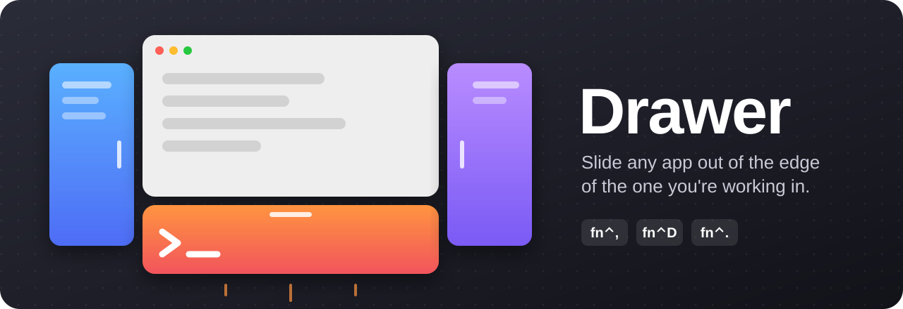
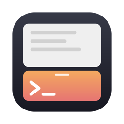
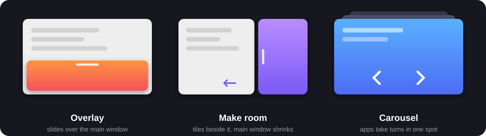
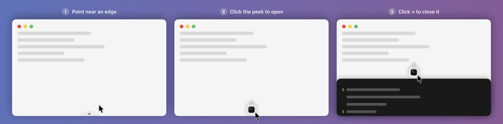
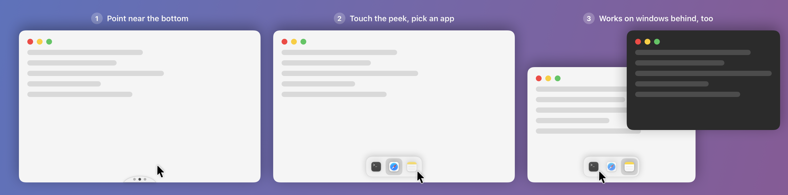

<p align="center">
  
</p>

<p align="center">
  <br>
  <b>A tiny macOS menu bar app that turns your apps into drawers.</b><br>
  Keep a terminal, database client, file browser or chat tucked behind any window, one keystroke away.
</p>

<p align="center">
  <a href="https://github.com/sponsors/zacksmash"></a>
  
  
</p>

---

## What it does

Pick a **main app** (your editor, browser, whatever you live in) and give it **drawers**: other apps that slide out from its left, bottom or right edge on a shortcut, sized to its window. Press the shortcut again and they slide away. Or put several apps in a **carousel** and flick between them in the same spot.

<p align="center">
  
</p>

- **Overlay**: the drawer slides over the main window, like a pull-down terminal.
- **Make room**: the drawer tiles beside it and the main window shrinks to fit, then grows back when it closes.
- **Carousel**: apps take turns in one spot. Next and previous switch to the next app in place, with a small dock showing which.

## Install

> [!WARNING]
> **Drawer isn't signed with a paid Apple Developer account**, so it isn't notarized by Apple. That's a $99/year membership, and Drawer is a free side project.
>
> - **Building from source** (below) is the easiest way: an app you build yourself isn't flagged by Gatekeeper.
> - **If you download a pre-built copy** (DMG or zip) from [Releases](https://github.com/zacksmash/drawer/releases/latest), macOS will refuse to open it the first time. Go to **System Settings → Privacy & Security** and click **Open Anyway**, or clear the download flag once:
>   ```bash
>   xattr -dr com.apple.quarantine /Applications/Drawer.app
>   ```
>
> If Drawer earns a spot in your day and you'd like it to open without any of this, [**sponsoring me on GitHub**](https://github.com/sponsors/zacksmash) goes straight toward the developer account that makes notarized releases possible. 💛

### Build from source

You need macOS 14 or later and the Xcode Command Line Tools (`xcode-select --install`).

```bash
git clone https://github.com/zacksmash/drawer.git
cd drawer
./Drawer/build.sh --install     # builds, quits any running Drawer, copies it to /Applications
open /Applications/Drawer.app
```

On first launch Drawer asks for **Accessibility** permission (System Settings → Privacy & Security → Accessibility). It needs this to move and resize other apps' windows and to see its shortcuts. Nothing else is required: no Screen Recording, no network.

> [!TIP]
> `build.sh` signs with your own **Apple Development** certificate if you have one (a free Apple ID in Xcode is enough). That keeps the Accessibility permission across rebuilds. Without one it signs ad hoc, and macOS will ask you to re-allow Drawer after each rebuild. Quit Drawer before removing it from the Accessibility list.

## Usage

Drawer lives in the menu bar. Open **Settings…** from its menu. For a step-by-step walkthrough with pictures, see the
**[guide](docs/guide.md)**.

### Drawers

1. **Drawers** tab → **Add Drawer…**
2. Choose the **main app** and the **drawer app**, the **edge** (left, bottom or right) and a **size** (⅓, ½, ⅔ or Full).
3. Turn on **Make room** to tile beside the main window instead of overlaying it.

Then, with the main app in front:

| Shortcut | Drawer |
| --- | --- |
| <kbd>fn</kbd> <kbd>⌃</kbd> <kbd>,</kbd> | Left |
| <kbd>fn</kbd> <kbd>⌃</kbd> <kbd>D</kbd> | Bottom |
| <kbd>fn</kbd> <kbd>⌃</kbd> <kbd>.</kbd> | Right |

Change them under **General → Keyboard**, or give a single drawer its own shortcut. Or use the pointer:

<p align="center">
  <picture>
    <source media="(prefers-color-scheme: dark)" srcset="docs/peeks-dark.png">
    
  </picture>
</p>

- **Hold to peek**: hold the shortcut to show the drawer, let go to hide it.
- **Edge peeks**: point near the middle of the main window's left, bottom or right edge and a small arc peeks out with a chevron. Point at it and it grows into the drawer app's icon; click to open that drawer. While it's open, the same peek shows an × and closes it; for an overlay drawer, which covers that edge, it's on the drawer's inner edge (top of a bottom drawer, right side of a left one). Peeks work on any main window under the pointer, even one that isn't in front (Drawers → Peek at the edges).
- **Resize**: drag the drawer's inner edge (the one facing the main window). The new size is saved. **Double-click** that edge to go back to the previous size.
- **Traffic lights** on an open drawer do drawer things. <kbd>⌥</kbd>-click for the usual behaviour.
  - 🔴 slides the drawer away. The app keeps its window and state.
    For apps like TablePlus, where closing a window takes you back to a picker, turn on **Red button closes the window** for that drawer.
  - 🟡 lets it out as a normal window, with a little *pop*. The shortcut docks it again.
  - 🟢 switches between its size and Full.
- **Drag a drawer out** by its title bar to use it as a normal window. Close it and it goes back to its drawer spot next time.
- **Click the main window** to dismiss overlay drawers. Coming back to it from another app with a click brings them back on top instead. **Move the main window** and its drawers hide instantly.
- **Switching to a drawer or carousel app** from the Dock or <kbd>⌘</kbd><kbd>Tab</kbd> puts it in its spot (General → Open drawer apps in their drawer).

### Carousels

1. **Carousels** tab → **Add Carousel…**
2. Choose a **main app**, then **Add App** for each app in the rotation. Reorder them with the arrows.

While any app in the carousel is in front, or under the pointer (General → Carousels follow the pointer):

| Input | Does |
| --- | --- |
| <kbd>fn</kbd> <kbd>⌃</kbd> <kbd>.</kbd> | Next app |
| <kbd>fn</kbd> <kbd>⌃</kbd> <kbd>,</kbd> | Previous app |
| <kbd>fn</kbd> + two-finger swipe | Next or previous (one finger on a Magic Mouse) |
| Hold the shortcut | Peek at the next app, let go to come back |
| Click an icon in the switcher | Switches straight to that app |
| <kbd>fn</kbd> <kbd>⌃</kbd> <kbd>S</kbd> | Shows or hides the switcher |

<p align="center">
  <picture>
    <source media="(prefers-color-scheme: dark)" srcset="docs/switcher-dark.png">
    
  </picture>
</p>

The **switcher** is a small row of the carousel's app icons on the app showing now: the carousel window under the pointer, even one that isn't in front, else the one in front. By default a small arc peeks up when the pointer nears the middle of the window's bottom edge; touch it with the pointer and the switcher springs open. Move away and it drops back to the peek, which stays while the pointer is still in that area and tucks away a second after it leaves. It stays open while a click switches apps. It also opens on <kbd>fn</kbd> <kbd>⌃</kbd> <kbd>S</kbd> (hold it to show the switcher until you let go). Under **Carousels** you can move it to the top, show it always or only on the shortcut, change the shortcut, or turn it off.

Move or resize whichever app is showing and the rest follow. The carousel's spot is wherever the current app's window is.

> [!NOTE]
> In a carousel app, <kbd>fn</kbd><kbd>⌃</kbd><kbd>,</kbd> and <kbd>fn</kbd><kbd>⌃</kbd><kbd>.</kbd> cycle the carousel, so left and right drawers on that app won't open. Bottom drawers still work. Settings shows a warning when this applies.

## Good to know

- Drawer only moves and resizes windows through the Accessibility API. It never injects into or modifies other apps.
- Apps with a minimum window size (some won't go below a certain height) are fitted as closely as they allow.
- A window on another desktop (Space) is brought over to the current one before it slides in, for drawers and carousels alike. If macOS won't allow it, Drawer suggests assigning that app to **All Desktops** (right-click its Dock icon → Options).
- With several displays, a drawer whose edge borders another display stays mostly on its own display while closed, so it can't wander onto the other display's desktop. It slides out of that edge starting part of the way out.
- Built and tested on macOS 27. It needs macOS 14 or later.

## Support

Drawer is free and built in spare time. If it saves you a few hundred <kbd>⌘</kbd><kbd>Tab</kbd>s a day:

<p align="center">
  <a href="https://github.com/sponsors/zacksmash"><b>❤️ Sponsor @zacksmash on GitHub</b></a>
</p>

Sponsorships help cover an Apple Developer account, so future releases can be signed and notarized and open with a double-click. Bug reports and ideas are welcome in [Issues](https://github.com/zacksmash/drawer/issues).

## License

[MIT](LICENSE) © Zack Warren
