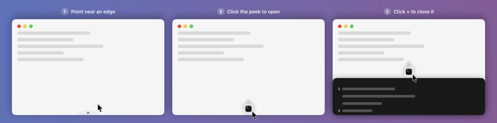
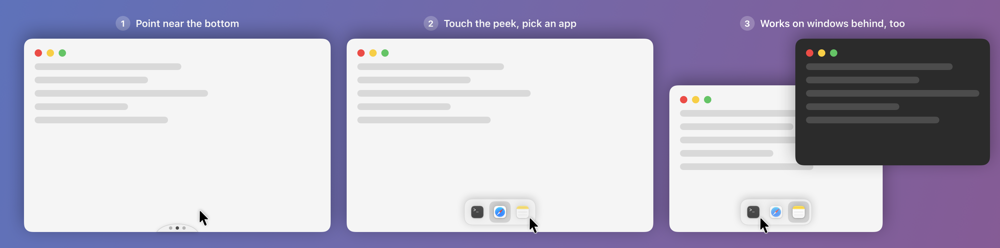

# Drawer guide

A walk through everything Drawer does, from your first drawer to carousels. If you haven't installed it yet, start with
[Install](../README.md#install) in the README.

- [1. Allow Accessibility](#1-allow-accessibility)
- [2. Make a drawer](#2-make-a-drawer)
- [3. Open and close it](#3-open-and-close-it)
- [4. Living with an open drawer](#4-living-with-an-open-drawer)
- [5. Make a carousel](#5-make-a-carousel)
- [6. Switch apps in a carousel](#6-switch-apps-in-a-carousel)
- [7. Other desktops and displays](#7-other-desktops-and-displays)

## 1. Allow Accessibility

Drawer moves and resizes other apps' windows, and it needs **Accessibility** permission for that. On first launch it
asks. Turn Drawer on under **System Settings → Privacy & Security → Accessibility**. That's the only permission it
uses: no Screen Recording, no network.

Drawer lives in the menu bar. Everything below starts from its menu → **Settings…**.

## 2. Make a drawer

A drawer pairs a **main app** (the one you work in) with a **drawer app** that slides out of one of its edges.

1. **Drawers** tab → **Add Drawer…**
2. Pick the **main app** (say, your editor) and the **drawer app** (say, a terminal).
3. Pick the **edge**: left, bottom or right.
4. Pick a **size**: ⅓, ½, ⅔ or Full of the main window.
5. Choose how it sits:
   - **Overlay** (default): the drawer slides over the main window.
   - **Make room**: the drawer tiles beside it and the main window shrinks to fit, then grows back when it closes.

A main app can have one drawer per edge.

## 3. Open and close it

### With the keyboard

With the main app in front:

| Shortcut | Drawer |
| --- | --- |
| <kbd>fn</kbd> <kbd>⌃</kbd> <kbd>,</kbd> | Left |
| <kbd>fn</kbd> <kbd>⌃</kbd> <kbd>D</kbd> | Bottom |
| <kbd>fn</kbd> <kbd>⌃</kbd> <kbd>.</kbd> | Right |

Press it again to slide the drawer away. **Hold** it instead to peek: the drawer shows while you hold it and hides when
you let go. Change the shortcuts under **General → Keyboard**, or give one drawer its own.

### With the pointer

<picture>
  <source media="(prefers-color-scheme: dark)" srcset="peeks-dark.png">
  
</picture>

1. **Point near the middle of an edge** that has a drawer. A small arc peeks out of it with a chevron.
2. **Point at the peek** and it grows into the drawer app's icon. **Click** to open the drawer. Nothing opens until you
   click, so passing by is harmless.
3. **While it's open**, the same peek shows an **×**. Click it to close the drawer. For an overlay drawer, which covers
   that edge, the peek sits on the drawer's inner edge instead.

The peek tucks away a second after the pointer leaves. It works on any main window under the pointer, even one that
isn't in front: clicking it brings that app forward. Turn peeks off under **Drawers → Peek at the edges**.

## 4. Living with an open drawer

- **Resize**: drag the drawer's inner edge (the one facing the main window). Drawer remembers the new size.
  **Double-click** that edge to go back to the previous size.
- **Traffic lights** do drawer things (<kbd>⌥</kbd>-click for the usual behaviour):
  - 🔴 slides the drawer away. The app keeps its window and state. For apps like TablePlus, where closing a window
    takes you back to a picker, turn on **Red button closes the window** for that drawer.
  - 🟡 lets it out as a normal window. Its shortcut docks it again.
  - 🟢 switches between its size and Full.
- **Drag a drawer out** by its title bar to use it as a normal window. Close it and it goes back to its spot next time.
- **Click the main window** to dismiss overlay drawers. Coming back to it from another app with a click brings them back
  on top instead.
- **Move the main window** and its drawers hide instantly.
- **Switch to a drawer app** from the Dock or <kbd>⌘</kbd><kbd>Tab</kbd> and it opens in its drawer
  (**General → Open drawer apps in their drawer**).

## 5. Make a carousel

A carousel is a few apps that take turns in one spot, like slides.

1. **Carousels** tab → **Add Carousel…**
2. Pick a **main app**, then **Add App** for each app in the rotation. Reorder them with the arrows.

Move or resize whichever app is showing and the rest follow: the carousel's spot is wherever the current app's window
is.

## 6. Switch apps in a carousel

### With the switcher

<picture>
  <source media="(prefers-color-scheme: dark)" srcset="switcher-dark.png">
  
</picture>

1. **Point near the middle of the window's bottom edge.** A small arc peeks up, with a dot for each app; the filled dot
   is the one showing.
2. **Touch the peek** and it springs open into a row of the carousel's apps. **Click one** to switch straight to it.
   Move away and it drops back to the peek, which tucks away a second after the pointer leaves.
3. **It works on windows behind others, too**: whichever carousel window is under the pointer gets the switcher.

<kbd>fn</kbd> <kbd>⌃</kbd> <kbd>S</kbd> also shows or hides it (hold it to show it until you let go). Under
**Carousels** you can move it to the top, show it always or only on the shortcut, change the shortcut, or turn it off.

### With the keyboard or trackpad

While a carousel app is in front, or under the pointer (**General → Carousels follow the pointer**):

| Input | Does |
| --- | --- |
| <kbd>fn</kbd> <kbd>⌃</kbd> <kbd>.</kbd> | Next app |
| <kbd>fn</kbd> <kbd>⌃</kbd> <kbd>,</kbd> | Previous app |
| <kbd>fn</kbd> + two-finger swipe | Next or previous (one finger on a Magic Mouse) |
| Hold the shortcut | Peek at the next app, let go to come back |

Switches are instant, and the switcher flashes up with the incoming app highlighted.

> [!NOTE]
> In a carousel app, <kbd>fn</kbd><kbd>⌃</kbd><kbd>,</kbd> and <kbd>fn</kbd><kbd>⌃</kbd><kbd>.</kbd> cycle the
> carousel, so left and right drawers on that app won't open from the keyboard; their edge peeks still work. Bottom
> drawers open as usual, though with the switcher on the bottom edge they have no peek.

## 7. Other desktops and displays

- A drawer or carousel window left on another desktop (Space) is brought over to the one you're on. If macOS won't
  allow it, Drawer suggests assigning that app to **All Desktops** (right-click its Dock icon → Options).
- With several displays, a closed drawer whose edge borders another display stays mostly on its own display, so it
  can't wander onto the other display's desktop.
